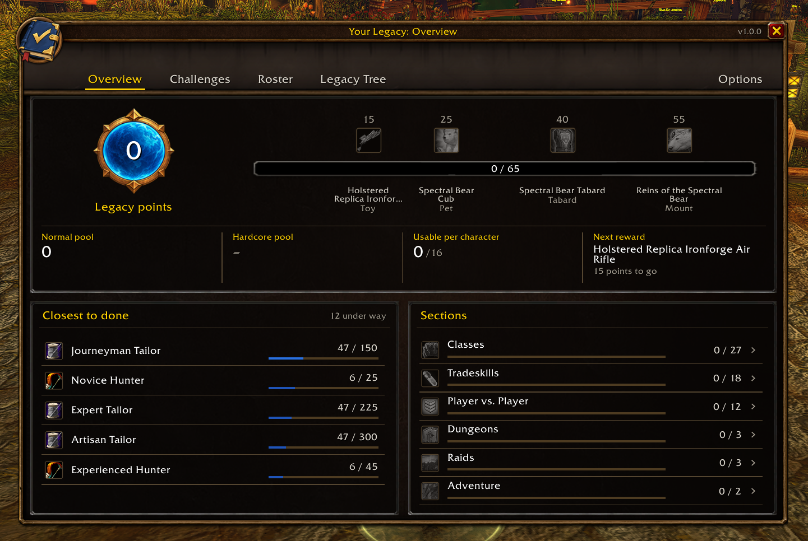
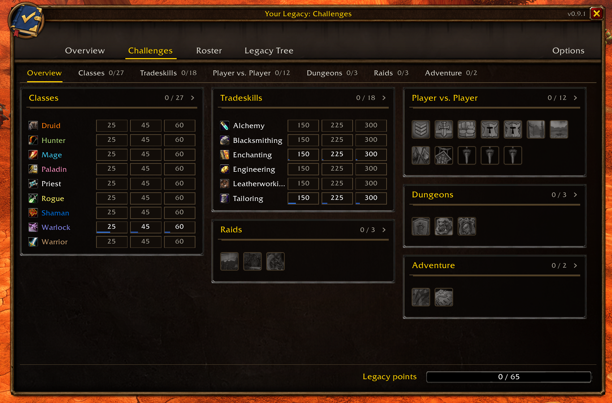
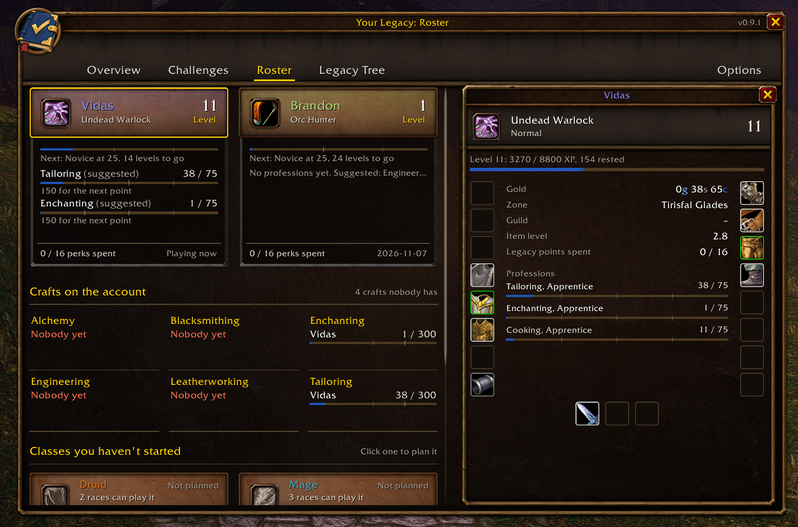
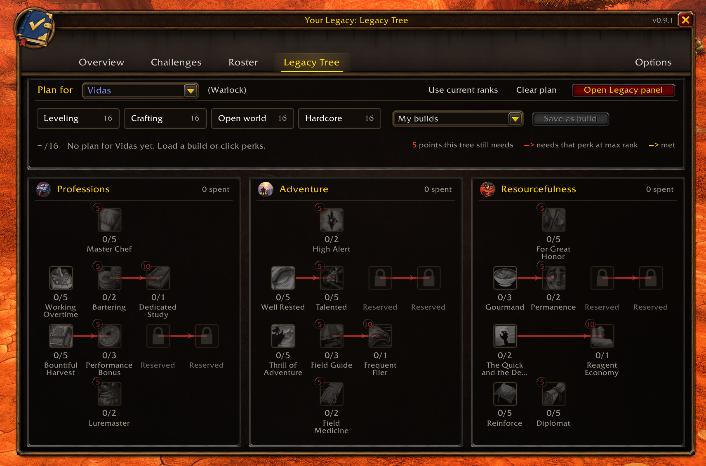
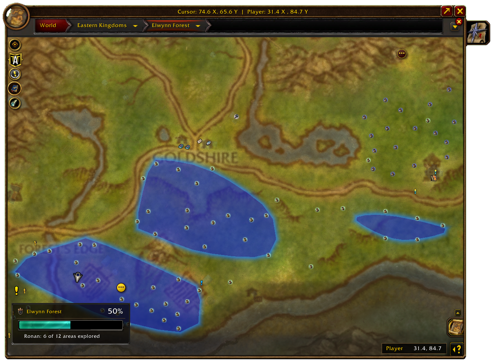

# Your Legacy

Your Legacy puts WoW Forever's Legacy system into one window that looks like part of the game. It shows your points and what they unlock, every challenge sorted the way the game sorts them, all your characters side by side, and a plan for each character's Legacy tree.

Open it with `/yl`, the minimap button, the addon compartment or a keybinding.

## Overview

*Your points, the reward track, both pools and the challenges closest to done.*

- Your Legacy points on the Legacy emblem, and the reward track with the toy, pet, tabard and mount. Click a reward to preview it.
- When you've unlocked a reward but not picked it up yet, it tells you it's waiting at Innkeeper Wiley in Ratchet.
- Your Normal and Hardcore pools, how many points one character can spend (16), and your next reward.
- The challenges closest to done (with how far the next reward is), and every section with its progress. Click a section to jump to it.

## Challenges

*Every section at a glance, with Classes and Tradeskills as grids.*

- One tab per section, plus an overview tab with every challenge at a glance.
- Classes and Tradeskills are grids: a row per class or craft, a cell per milestone.
- Dungeon tiers, raids and Explorer unfold into a checklist of their parts.
- Filter by open, in progress, done or all.
- The tooltip explains how a challenge counts, that it's earned once for the account, and which character did which part. For Explorer it names the character that's closest and the zones still missing.
- Click a challenge to open it in Blizzard's Legacy panel, or Shift-click to track it in the objective tracker. With the chat box open, Shift-click links it in chat instead.
- Sort a section by closest to done, most points or name.
- A cell lights up once when a challenge completes while the window is open.

## Roster

*A card per character, the crafts on the account, and the planner for a class you haven't started.*

- A card for every character you've logged in with: level, the next class milestone, both professions with the skill their next Legacy point needs, and the level a profession rank is waiting on.
- The crafts that suit the class, and perk ranks that no longer help at the character's level.
- Crafts on the account: who has each crafting profession, and which ones nobody has yet, so their challenges are still open.
- Click a card for that character's gear, gold, zone, guild, item level, XP and professions, in a panel beside the window. Characters you aren't playing show their last logout.
- Give a character a role (Main, Alt, Crafter, Bank or Ignore). Ignore hides its card.
- Each card shows how many Legacy points that character can still spend, and when the account earns a point a chat line names the characters that can spend it.
- For classes you haven't started, plan the ruleset, race and two crafts and see how many Legacy points that plan is worth.

## Legacy Tree

*A plan on the game's own tree, with presets, saved builds and what each perk still needs.*

- Plan perks for each character on the game's own tree layout.
- Each perk shows what it still needs: points in its tree, or another perk at max rank.
- Start from a preset (Leveling, Crafting, Open world, Hardcore), copy the ranks you have now, or save your own builds.
- Share a plan as text and import someone else's from the My builds list.
- The tab shows how many points you can still spend.
- A plan that takes ranks back warns you first: undoing ranks needs a paid reset at your class trainer, and the reset clears every rank. Below level 60 it also tells you when Talented means unlearning class talents first. Hover the line for what the plan learns and takes back.
- Perks that raise a chance say so in their tooltip.
- The 16-point cap is always in view.
- A button opens Blizzard's Legacy panel, which is where perks are learned. It works before your first Legacy point too, and so do the game's own Legacy key and menu button (you can switch that off in the options).

## Dungeons, raids and the world map

*The zone banner on the world map: exploration, dungeons with their level range, and the share done.*

- Step into a dungeon or raid that counts toward a challenge and a chat line tells you which one, and what's still missing there. After a boss dies it says whether the kill counted. `/yl here` repeats it at any time.
- On the world map, a banner shows how far along the zone you're looking at is: this character's exploration, and every dungeon and raid with its entrance there and its level range. Hover it for the areas you haven't found. Drag it wherever you like.
- Forever doesn't tell addons where dungeon entrances are, so the banner uses Questie's dungeon list when Questie is installed (plus the new Forever dungeons Questie doesn't list yet).
- With OpenMap installed, its dungeon cards get a Your Legacy section saying what the dungeon still counts for.
- `/yl here` also works in the open world: what the zone still counts for and the areas left to find.
- A Your Legacy button sits with the other map buttons. Click it to switch the banner off, put it back in its corner, or open the addon.

## Options

Grouped into Window (size from 80 to 150%, the progress bars' fill texture, lock, close in combat, animations), Chat and sound (a chat line, a guild announcement and a sound when you earn a challenge, reminders at login for unspent points and rewards to collect, the dungeon and raid help), Maps (the zone banner, the map button, the minimap button), How Legacy works (the rules Your Legacy relies on and how sure we are of each) and Data (an export of the addon's data, a report to paste into a bug report, and a check of what the addon relies on in your client).

## Good to know

- It only reads what the game reports. It doesn't change how challenges count, and it never spends points for you.
- No libraries needed. If another addon has loaded LibDBIcon, the minimap button joins your button collector.
- Titan Panel, ElvUI and other data broker bars can show your points and the next reward.
- It doesn't refresh during combat, and by default the window closes when combat starts.
- English and German, following your game client.
- A character appears on the Roster after you've logged in with it once.

## Commands

| Command | What it does |
|---|---|
| `/yl` | Open or close the window |
| `/yl options` | Open the options |
| `/yl status` | Print your points in chat |
| `/yl here` | Say what the dungeon, raid or zone you're in still counts toward |
| `/yl report` | Build a report for a bug report (add a challenge's name for its parts) |
| `/yl probe` | Check what Your Legacy relies on in your client |
| `/yl export` | Show the saved data as text you can copy |
| `/yl reset` | Clear everything the addon saved |

## Install

- **CurseForge app or WowUp:** search for *Your Legacy* with WoW Forever selected.
- **By hand:** download `YourLegacy-<version>.zip` from [Releases](https://github.com/EmberCatz/YourLegacy/releases) and unzip it into `World of Warcraft\_forever_\Interface\AddOns`, so you end up with `AddOns\YourLegacy\YourLegacy.toc`.

CurseForge page: <https://www.curseforge.com/wow/addons/your-legacy>

## Feedback

Found a bug or a number that looks wrong? Open an issue here or leave a comment on CurseForge saying what you expected and what you saw, and which page it was on. `/yl report` gives you text to paste along with it.

## License

MIT. See [LICENSE](LICENSE).
